# BPMN Token Simulation — Architecture Diagrams

## Document Information

| Field | Value |
|---|---|
| Document Type | Software Architecture Diagram Pack |
| System | BPMN Token Simulation |
| Diagram Notation | Mermaid |
| Architecture Views | System Context, Logical Containers, Components, Runtime Sequences, Data Flow, Deployment, State Models, Integration Contracts |
| Architectural References | C4 Model concepts, ISO/IEC/IEEE 42010 principles, ISO/IEC 25010 quality attributes |
| Status | Architecture documentation |
| Primary Audience | Software Architects, Developers, Technical Reviewers, Maintainers |

> **Documentation scope:** These diagrams describe the system architecture and its interactions at the level supported by the documented design. They are not, by themselves, proof of implementation behavior, production deployment, API guarantees, or standards certification. Implementation-specific details must be verified against the corresponding source code and service contracts.

---

## 1. How to Read This Document

This document provides complementary views of the BPMN Token Simulation system, from its external context to its internal runtime behavior.

Each diagram addresses a specific architectural concern:

| Section | View | Primary Concern |
|---|---|---|
| 2 | System Context | External actors and system boundaries |
| 3 | Logical Container View | Runtime environments and major deployable or logical units |
| 4 | Component View | Responsibilities and dependencies within the browser runtime |
| 5.1 | Runtime Sequence | XML-driven simulation execution |
| 5.2 | Runtime Sequence | Simulation event capture and telemetry submission |
| 5.3 | Runtime Sequence | Kernel tick and job processing |
| 6 | Data Flow | Configuration, execution, and telemetry lifecycle |
| 7 | Deployment | Development and production topology |
| 8.1 | State Model | Simulation lifecycle |
| 8.2 | State Model | Token execution lifecycle |
| 8.3 | State Model | Scope and gateway execution |
| 9 | Architecture Decision Map | Key design concerns and trade-offs |
| 10 | Integration Contracts | Backend interaction boundaries |
| 11 | Traceability | Relationship between diagrams and architecture documentation |
| 12 | Maintenance Rules | Governance and consistency requirements |

### Modeling conventions

- **Solid arrows** represent a documented or intended interaction or dependency.
- **Dashed arrows** represent optional, asynchronous, external, or otherwise conditional interactions where the distinction is explicitly identified.
- **Logical components** represent software responsibilities, not necessarily independently deployable services.
- **External systems** are outside the simulation runtime's ownership boundary.
- **Conceptual or future-state elements** must be labeled explicitly and must not be interpreted as implemented functionality.
- Mermaid diagrams provide architectural views; they do not replace executable tests, API specifications, source-level dependency analysis, or deployment configuration.

The diagrams should be updated whenever a change materially affects component ownership, runtime interactions, data contracts, state transitions, or deployment boundaries.

---

## 2. System Context — C4 Level 1

This view identifies the simulation system, its primary users, and the external systems with which it interacts.

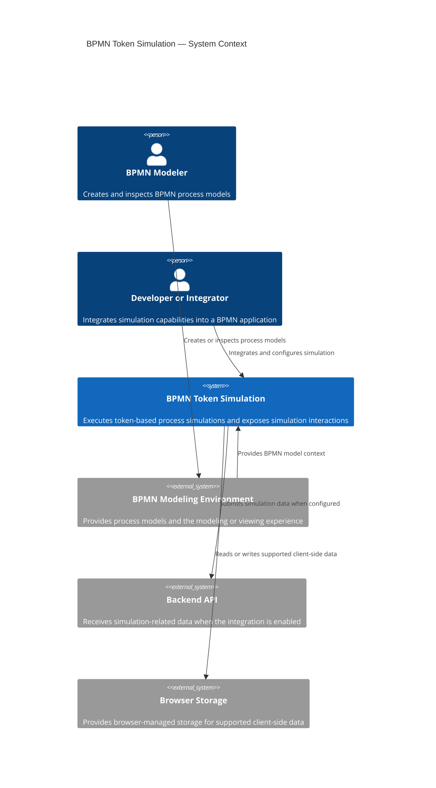

### Interpretation

The simulation system is primarily a browser-side capability integrated with a BPMN modeling or viewing environment.

Its core responsibility is simulation execution. Backend communication and browser storage are supporting capabilities, not necessarily part of the execution kernel.

The context diagram intentionally does not prescribe backend persistence semantics, authentication mechanisms, or the exact transport protocol. Those concerns belong to the integration contract and implementation documentation.

---

## 3. Logical Container View — C4-Inspired Level 2

This view distinguishes runtime environments from logical software units. It avoids treating a source directory or browser storage mechanism as an independently deployed application container.

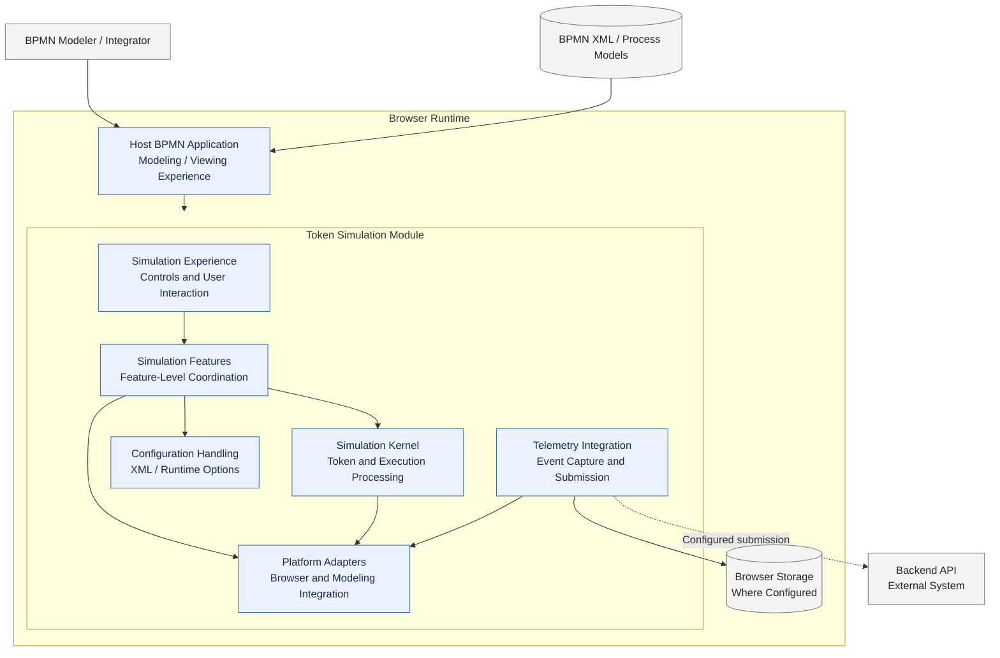

### Container and boundary definitions

| Element | Classification | Responsibility |
|---|---|---|
| Host BPMN Application | Host application | Provides the modeling or viewing environment |
| Token Simulation Module | Logical software module | Encapsulates simulation-related functionality |
| Simulation Experience | Logical component | Coordinates user-facing simulation interactions |
| Simulation Features | Logical component group | Implements feature-level behavior and coordination |
| Simulation Kernel | Logical component | Processes simulation execution and token-related behavior |
| Platform Adapters | Logical component group | Integrates with browser APIs and host modeling capabilities |
| Configuration Handling | Logical component | Interprets and applies supported runtime configuration |
| Telemetry Integration | Logical component | Captures and submits supported simulation information |
| Browser Storage | Browser-managed facility | Stores supported client-side data |
| Backend API | External service | Exposes the server-side integration contract |
| BPMN XML / Process Models | Data resource | Supplies process definitions |

### Architectural constraints

1. The simulation module is not assumed to be an independently deployed service.
2. `lib/` is a source-code organization boundary, not automatically a deployment boundary.
3. Browser storage is a platform facility, not an application container.
4. Backend integration must remain separate from core simulation execution unless the implementation explicitly establishes a dependency.
5. The diagram does not imply that every component is independently instantiated or that the host application follows a particular deployment model.
6. Actual module dependencies and ownership must be verified against source imports, initialization code, and runtime registration.

---

## 4. Component View — Browser Runtime

This view describes the major logical responsibilities within the simulation module.

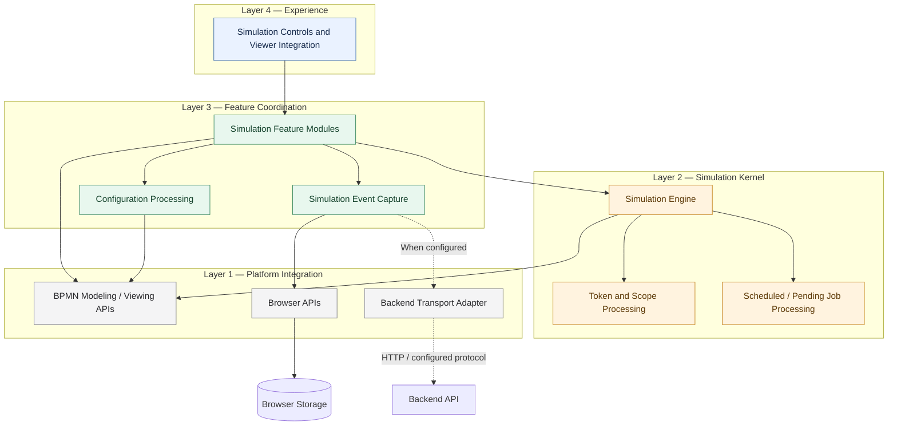

### Responsibility boundaries

**Experience layer**

- Exposes simulation controls and viewer-facing interactions.
- Delegates simulation operations to the appropriate feature or engine interface.
- Should not independently implement core token execution semantics.

**Feature coordination layer**

- Coordinates configuration, feature behavior, and simulation-related event capture.
- Integrates feature-specific logic with the engine and host modeling environment.
- Should avoid duplicating kernel-level execution rules.

**Simulation kernel**

- Owns or coordinates token execution and simulation scheduling according to the implemented design.
- Defines the execution behavior of the simulation engine.
- Should not require successful telemetry delivery for a simulation step unless an explicit architectural requirement establishes that dependency.

**Platform integration layer**

- Encapsulates interactions with the host BPMN environment, browser capabilities, and external transport.
- Provides a boundary between execution logic and environment-specific APIs.

### Dependency rules

The diagram illustrates logical responsibilities, not a claim that the source code implements four formal packages.

The intended dependency direction is from user-facing coordination toward simulation behavior and platform abstractions. Exceptions must be documented when the host modeling framework, event bus, or lifecycle registration mechanism requires a different direction.

Before enforcing these rules, verify them against the actual module imports, service registration, event subscriptions, and initialization order.

---

## 5. Runtime Sequence Diagrams

### 5.1 XML-Driven Simulation Execution

This sequence describes the conceptual flow from loading a process model to starting simulation execution.

It does not assume a particular XML schema, defaulting policy, or error-handling mechanism beyond the operations shown.

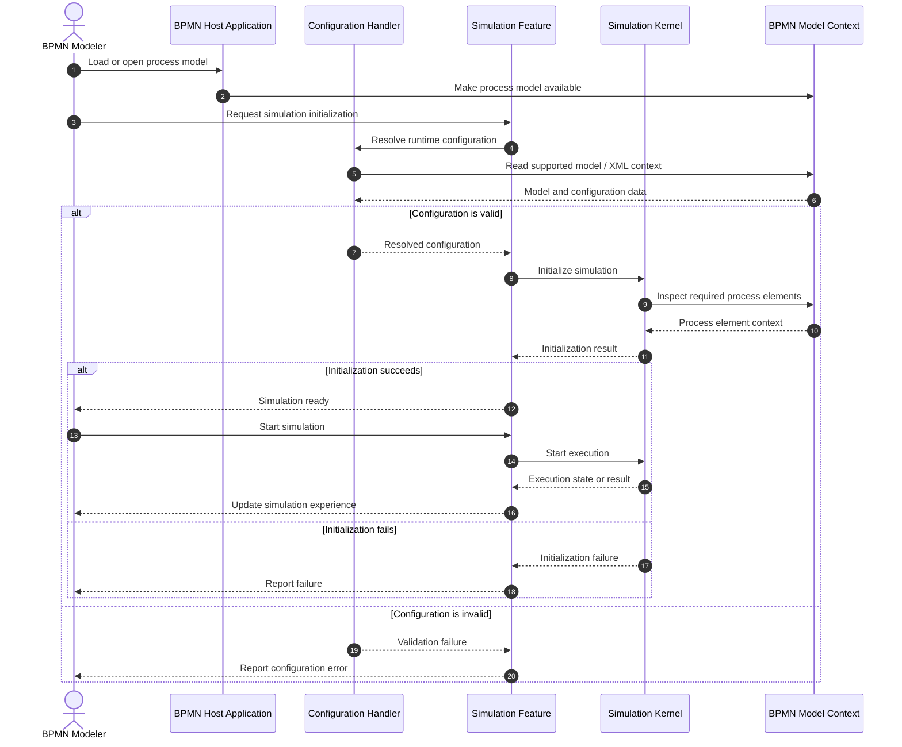

#### Architectural considerations

- Configuration resolution and simulation initialization are separate responsibilities.
- Invalid configuration should not be represented as a successful initialization.
- The host modeling environment provides process context; it should not be confused with the simulation kernel.
- The exact validation stages, error types, and initialization side effects must match the implementation.
- If runtime configuration is supplied through a separate API rather than model XML, the sequence must be adjusted accordingly.

---

### 5.2 Simulation Event Capture and Telemetry Submission

This sequence separates event capture from session creation and event submission. It also distinguishes successful HTTP communication from confirmed durable persistence.

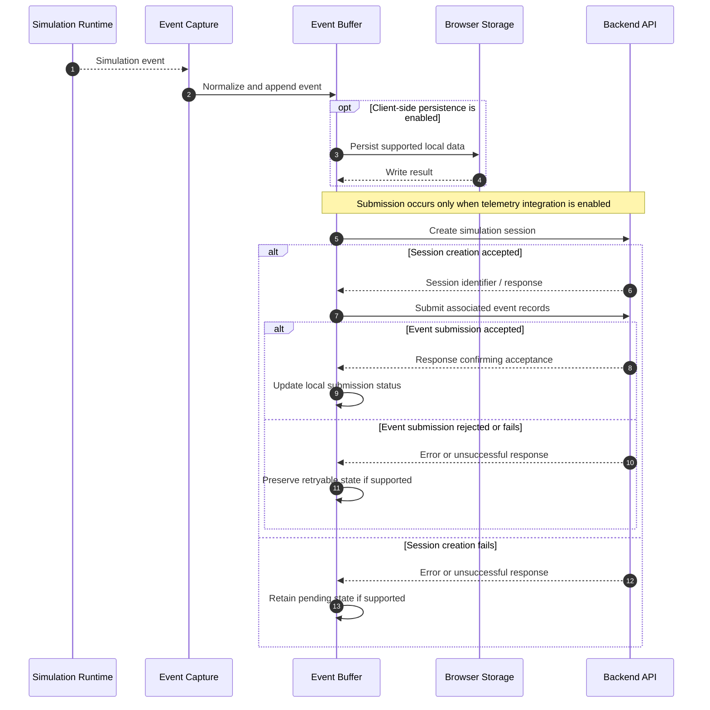

#### Telemetry design requirements

The diagram establishes distinct responsibilities for:

1. **Event capture** — observing a simulation-related event.
2. **Buffering** — holding events until the integration can submit them.
3. **Session creation** — obtaining the identifier required to associate records with a simulation session.
4. **Event submission** — transmitting event records under the applicable API contract.
5. **Submission tracking** — distinguishing pending, accepted, failed, and retryable operations where supported.

The sequence does not assert that a durable queue, automatic retry, or offline synchronization is currently implemented. Those behaviors require explicit implementation evidence.

#### Reliability and failure handling

- A failed session-creation request must not be treated as a successful session.
- Event submission must not proceed as though a valid session identifier exists when session creation fails.
- Network failure, server rejection, timeouts, and malformed responses should be distinguishable where the implementation supports them.
- Retries should be bounded and use an explicit retry policy.
- If the backend supports idempotency keys or unique event identifiers, retries should use them to reduce duplicate processing.
- If events are stored locally, retention limits, storage quotas, sensitive-data handling, and cleanup behavior should be documented.
- A successful HTTP response proves only the level of acceptance guaranteed by the endpoint contract. It does not independently prove durable storage, exactly-once processing, or downstream completion.

---

### 5.3 Simulation Kernel Tick and Job Processing

This view describes the conceptual execution loop and separates job scheduling from event capture.

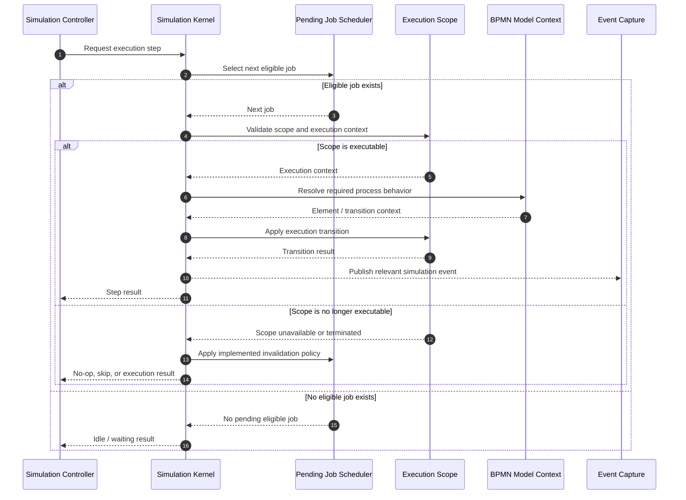

#### Kernel responsibilities

The kernel is responsible for coordinating execution according to the engine's actual scheduling and lifecycle rules.

The diagram does not prescribe whether a tick processes one job, multiple jobs, or a time-bounded batch. That behavior must be specified by the implementation.

#### Scheduling questions that must be resolved in code or documentation

- What triggers a tick: a timer, user action, event, or another scheduler?
- Is the job queue global, per scope, or distributed across execution contexts?
- How are jobs ordered when multiple jobs are eligible?
- What happens when a scope terminates while jobs remain pending?
- Can a job be executed more than once after interruption or retry?
- How are deadlocks, idle states, and completed simulations distinguished?
- What guarantees exist around event ordering and state consistency?

These are implementation-specific properties and must not be inferred solely from this sequence.

---

## 6. Data Flow — Configuration, Execution, and Telemetry

This view separates process input, runtime execution, event capture, and external telemetry submission.

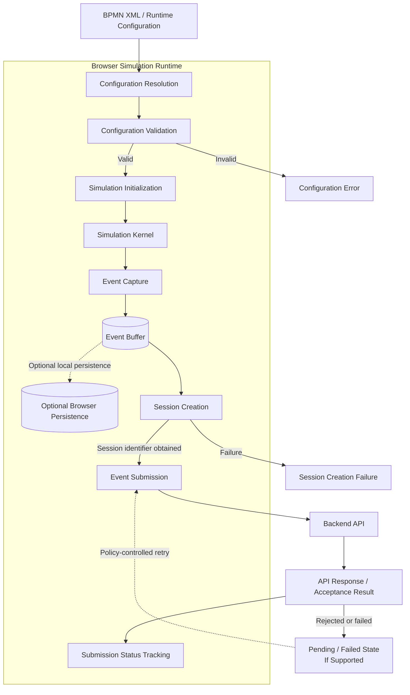

### Data flow stages

| Stage | Input | Output | Responsibility |
|---|---|---|---|
| Configuration resolution | BPMN XML and supported runtime options | Resolved configuration | Interpret configuration inputs |
| Validation | Resolved configuration | Valid configuration or error | Reject unsupported or invalid inputs |
| Initialization | Valid configuration and process context | Initialized execution context | Prepare the simulation |
| Execution | Initialized context and eligible jobs | State transitions and simulation events | Execute the process simulation |
| Event capture | Runtime events | Normalized event records | Observe and represent events |
| Buffering | Event records | Pending records | Coordinate later submission |
| Session creation | Session request | Session identifier or failure | Establish the server-side session when required |
| Event submission | Session identifier and event records | API response | Submit event records |
| Status tracking | API response | Local submission status | Represent known submission outcomes |

### Data ownership

- The simulation runtime owns its in-memory execution state.
- Browser persistence, when used, is a client-side storage mechanism and must not be assumed to provide unlimited capacity or guaranteed durability.
- The backend owns the server-side semantics of accepted session and event records.
- A locally captured event is not equivalent to a remotely accepted event.
- A remotely accepted event is not necessarily equivalent to a durably committed or fully processed record.

### Failure paths

The implementation should define the expected behavior for:

- Invalid configuration.
- Simulation initialization failure.
- Runtime execution errors.
- Event-capture errors.
- Browser storage failure or quota exhaustion.
- Session creation failure.
- Event submission failure.
- Authentication or authorization failure.
- Network interruption and server-side rejection.

Whether these failures interrupt simulation execution, affect only telemetry, or require user intervention must be documented according to the actual system behavior.

---

## 7. Deployment and Runtime Topology

The deployment model must distinguish development environments from production hosting. A local development server port must not be interpreted as a production endpoint.

### 7.1 Development topology

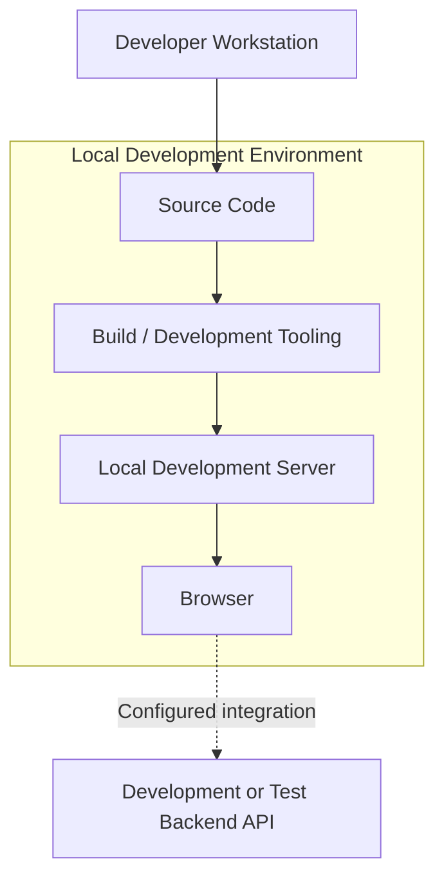

The development topology represents a typical workflow. The exact bundler, server port, backend URL, and test environment must be derived from project configuration.

### 7.2 Production topology

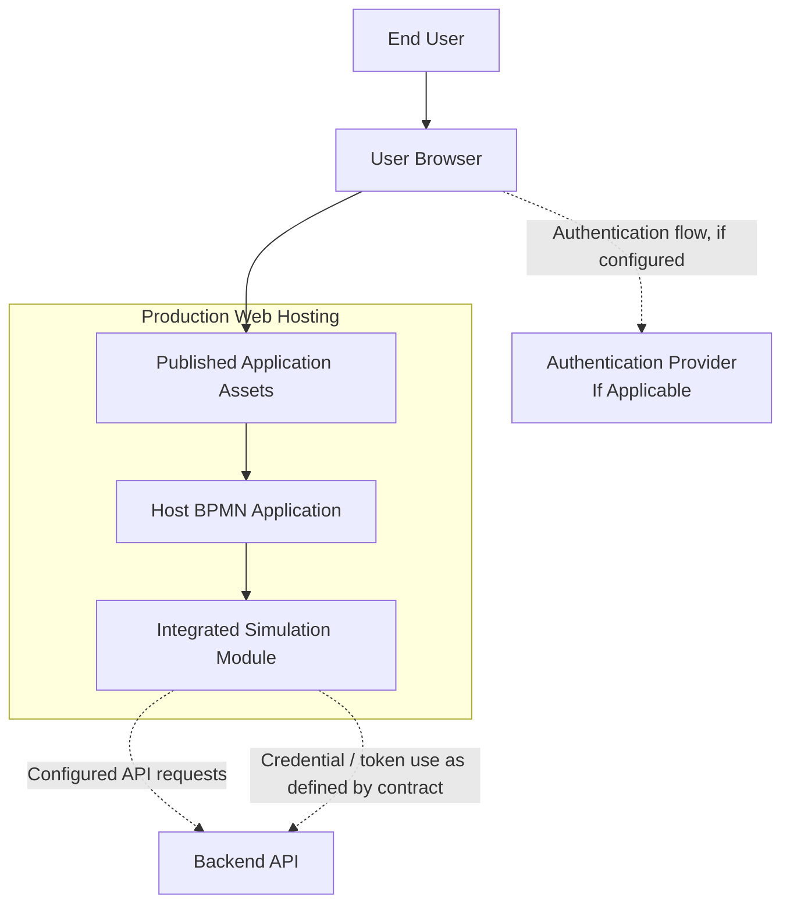

### Deployment considerations

1. **Hosting:** Identify the actual production asset host, CDN, application server, or package-consumption mechanism.
2. **Backend integration:** Document the configured API endpoint and whether it is same-origin or cross-origin.
3. **Authentication:** Identify the source of credentials, token lifetime, refresh behavior, and authorization scope where applicable.
4. **Transport security:** Production communication carrying credentials or sensitive data must use HTTPS.
5. **CORS and origin validation:** Document the applicable browser and server-side policies.
6. **Configuration management:** Avoid embedding privileged server credentials in browser-delivered bundles.
7. **Observability:** Distinguish client-side diagnostic events from server-side operational monitoring.
8. **Environment separation:** Development, testing, staging, and production endpoints and credentials must remain appropriately separated.

The topology is illustrative until verified against the actual deployment and hosting configuration. The presence of an authentication provider is conditional and must be removed from the diagram if the implementation does not use one.

---

## 8. State Models

The state models below deliberately separate simulation lifecycle, token execution, and scope or gateway behavior. These concepts have different responsibilities and should not be represented as mutually exclusive states in a single state machine.

### 8.1 Simulation Lifecycle

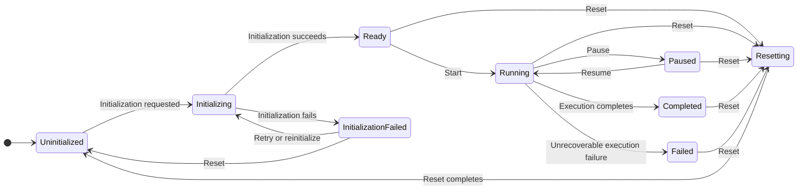

#### State semantics

| State | Meaning |
|---|---|
| `Uninitialized` | No initialized simulation execution context |
| `Initializing` | Initialization is in progress |
| `Ready` | Initialization has completed and execution can be started |
| `Running` | Simulation execution is active |
| `Paused` | Execution is suspended according to the implemented pause semantics |
| `Completed` | The simulation has reached its defined completion condition |
| `InitializationFailed` | Initialization did not complete successfully |
| `Failed` | Execution reached an unrecoverable failure state |
| `Resetting` | Existing simulation state is being reset |

This is a reference lifecycle model. The actual state names, allowed transitions, and reset behavior must match the implementation. If the engine does not explicitly expose a state, it should not be presented as an implemented API state.

### 8.2 Token Execution Lifecycle

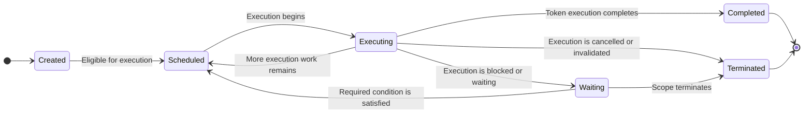

#### Token lifecycle interpretation

The model represents a conceptual execution lifecycle, not a claim that every state exists as an explicit token status in the code.

In particular:

- `Scheduled` describes eligibility for future processing.
- `Executing` describes active processing.
- `Waiting` describes an execution that cannot currently proceed.
- `Completed` and `Terminated` represent different outcomes.
- A BPMN gateway is a process element, not a token lifecycle state.
- A token may be represented by runtime objects, scheduled jobs, or other implementation-specific structures.

The actual token creation, movement, waiting, cancellation, and completion rules must be derived from the engine implementation.

### 8.3 Scope and Gateway Execution

A scope represents an execution context or lifecycle boundary where supported by the engine. A gateway represents BPMN routing behavior. They are related to token execution but are not interchangeable concepts.

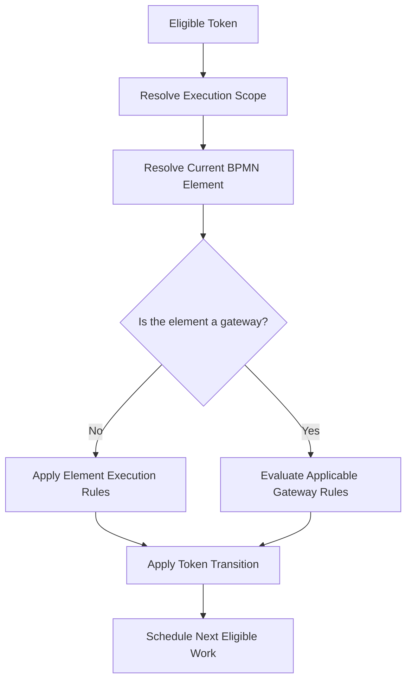

#### Gateway and scope considerations

- Gateway routing depends on the applicable BPMN element type and supported simulation semantics.
- Exclusive, parallel, inclusive, and event-based gateways must not be assumed to share identical execution rules.
- Scope termination may invalidate pending work, depending on the execution model.
- Parallel paths may produce multiple tokens, while other gateway types may select or coordinate paths differently.
- Token completion must not be equated automatically with overall simulation completion.
- The model above is intentionally a routing overview, not a complete BPMN 2.0 execution specification.

For production-grade documentation, gateway-specific semantics should be covered by dedicated state or sequence diagrams and corresponding automated tests.

---

## 9. Architecture Decision Map

This diagram groups the primary engineering concerns. It is a decision map, not a record of approved architectural decisions.

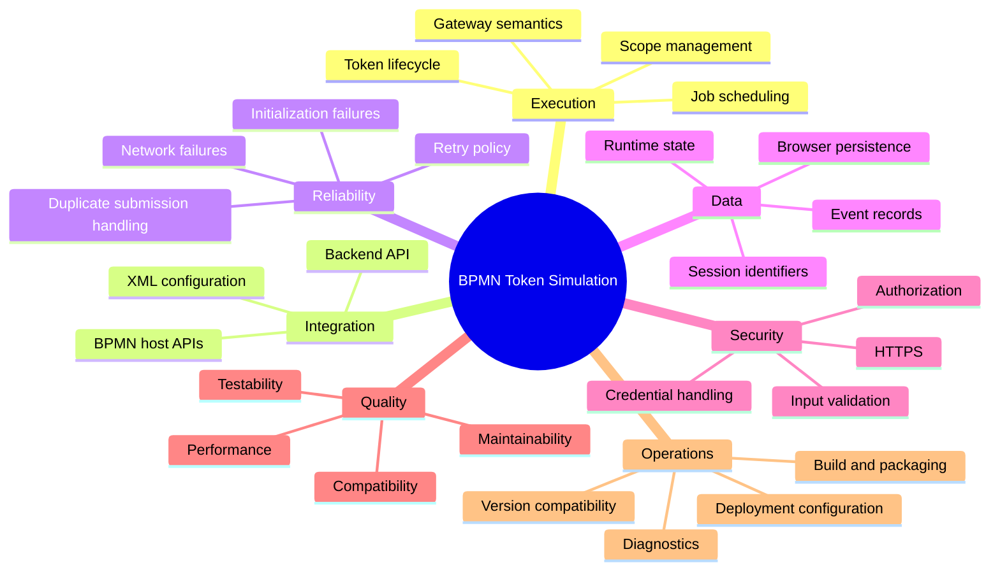

### Decision documentation requirements

For each significant architecture decision, maintain a separate record containing:

- Decision identifier and title.
- Context and problem statement.
- Decision and rationale.
- Alternatives considered.
- Consequences and trade-offs.
- Security, reliability, and performance implications.
- Implementation status.
- Links to related source code, tests, and diagrams.

A topic shown in this mind map is not evidence that a decision has been made or that a capability has been implemented.

---

## 10. Integration Contract Overview

This section describes the integration boundary between the browser-side simulation and an external backend API.

The endpoint names below reflect the documented integration naming. Exact methods, request bodies, response schemas, authentication requirements, and status codes must be confirmed against the actual API implementation or its OpenAPI specification.

### 10.1 Logical API operations

| Logical Operation | Documented Endpoint | Purpose | Contract Details to Verify |
|---|---|---|---|
| Token-related operation | `/token/` | Token-related API interaction | HTTP method, credential exchange, response schema, and authorization behavior |
| Create simulation | `/bt_simulations` | Create or register a simulation session | HTTP method, required fields, session identifier, validation, and response semantics |
| Submit simulation entries | `/bt_simulation_entry_log` | Submit simulation event or entry records | HTTP method, payload structure, session association, validation, and duplicate handling |
| List simulations | Implementation-specific | Retrieve simulation sessions | Actual route, method, filtering, pagination, and authorization |

> The `/token/` route name alone does not establish whether the API issues, validates, refreshes, or exchanges credentials. Its role must be documented from the real contract.

### 10.2 Logical interaction flow

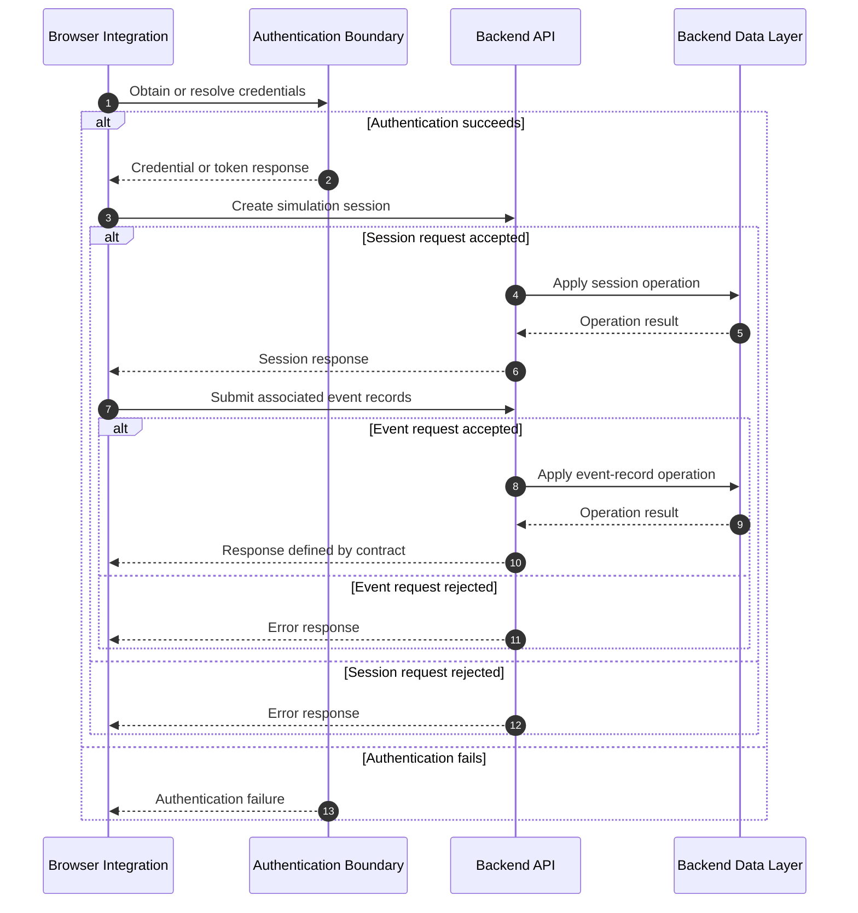

This is a logical contract view. It does not assert a particular database, transaction boundary, persistence guarantee, or credential mechanism. The backend data layer is shown to represent server-side responsibility, not a verified physical architecture.

### 10.3 Authentication and authorization requirements

The integration documentation should identify:

- Whether authentication is required for each endpoint.
- How credentials are obtained and where they are stored.
- Whether credentials are scoped to a user, organization, or service.
- How expiration and refresh are handled, if applicable.
- Which endpoints enforce authorization independently.
- How unauthenticated and unauthorized requests are represented.
- How secrets are prevented from entering browser bundles, logs, and URLs.
- Which CORS and origin policies apply to browser-originated requests.

Browser-side checks must not be treated as a substitute for server-side authorization.

### 10.4 Request and response semantics

For each operation, document the following when applicable:

| Contract Concern | Required Clarification |
|---|---|
| HTTP method | Actual supported method |
| Request schema | Required and optional fields, types, and constraints |
| Response schema | Success payload and identifier semantics |
| Validation | How invalid or incomplete requests are handled |
| Authentication | Credential requirements |
| Authorization | Access-control rules |
| Errors | Status codes and machine-readable error format |
| Idempotency | Whether repeated requests can safely be processed |
| Ordering | Whether event order matters and how it is represented |
| Persistence | What the response guarantees about server-side storage |
| Rate limiting | Limits and behavior when exceeded |
| Compatibility | API versioning and backward-compatibility policy |

### 10.5 Consistency and delivery guarantees

The architecture must distinguish between:

- Request transmission.
- Server acceptance.
- Durable persistence.
- Downstream processing.
- Client acknowledgement.

These are separate milestones.

Do not describe event records as `Durable`, `Committed`, or `Processed` unless the backend contract explicitly guarantees the corresponding property.

Likewise, do not claim exactly-once delivery based only on HTTP request/response behavior. If the system retries requests, document the idempotency strategy and the backend's duplicate-handling semantics.

---

## 11. Architecture Traceability Matrix

This matrix maps architectural concerns to the views that explain them. It is a documentation navigation aid rather than a formal compliance matrix.

| Architecture Concern | Primary Diagram | Related Sections | Verification Evidence |
|---|---|---|---|
| External system boundaries | System Context | 3, 7, 10 | Host integration and external service configuration |
| Browser runtime boundaries | Logical Container View | 4, 7 | Build configuration, module entry points, packaging |
| Component responsibilities | Component View | 5, 6 | Source imports, service registration, event subscriptions |
| XML-driven initialization | Sequence 5.1 | 6, 8 | Configuration parser, validation, initialization tests |
| Token execution | Sequence 5.3 | 8.2, 8.3 | Kernel implementation and token transition tests |
| Event capture | Sequence 5.2 | 4, 6 | Event subscriptions and event normalization logic |
| Session creation | Sequence 5.2 | 6, 10 | Actual request and response contract |
| Event submission | Sequence 5.2 | 6, 10 | Transport implementation and API tests |
| Failure handling | Sequences 5.1–5.3 | 6, 10 | Error-handling paths and automated failure tests |
| State transitions | State Models | 5, 6 | Runtime state definitions and transition tests |
| Deployment assumptions | Deployment Topology | 2, 3, 10 | CI/CD, hosting, environment configuration |
| Security boundaries | Deployment and Integration | 3, 7, 10 | Authentication, authorization, and security tests |
| Architectural decisions | Decision Map | All sections | Decision records and implementation references |

### Evidence hierarchy

When resolving discrepancies between the diagrams and the running system, use the following evidence hierarchy:

1. Verified runtime behavior and automated tests.
2. Actual implementation and configuration.
3. Authoritative API contracts and deployment definitions.
4. Architecture decision records and current architecture documentation.
5. Conceptual diagrams and roadmap descriptions.

A discrepancy should be resolved explicitly rather than silently changing a diagram to match an assumption.

---

## 12. Diagram Maintenance and Governance

### 12.1 Change management

Update this document when a change affects:

- System or runtime boundaries.
- Component responsibilities or dependencies.
- Configuration loading or validation.
- Token execution or gateway semantics.
- Simulation lifecycle and state transitions.
- Event capture, buffering, or telemetry delivery.
- Backend endpoint contracts.
- Authentication, authorization, or data protection.
- Deployment, packaging, or environment configuration.

### 12.2 Review checklist

Before merging a material architecture change, verify:

- [ ] Each diagram reflects the current implementation or is explicitly marked conceptual.
- [ ] Component and deployment boundaries are not conflated.
- [ ] All arrows represent meaningful interactions or dependencies.
- [ ] Request/response flows identify their relevant failure paths.
- [ ] Token, scope, gateway, and simulation states are modeled separately.
- [ ] API endpoint names and schemas match the actual contract.
- [ ] Persistence and delivery guarantees are not overstated.
- [ ] Authentication and trust boundaries are represented where relevant.
- [ ] Development-only configuration is not presented as production topology.
- [ ] Related architecture documentation and tests are updated.
- [ ] Mermaid syntax is rendered and checked in the target documentation platform.

### 12.3 Diagram quality requirements

Diagrams should:

1. Have a clearly stated purpose and scope.
2. Use consistent naming across the architecture documentation.
3. Show only the detail necessary for the viewpoint.
4. Separate implemented behavior from proposed behavior.
5. Avoid implying deployment, durability, security, or reliability guarantees without evidence.
6. Remain consistent with the source code and API contracts.
7. Be understandable without requiring the reader to infer missing transitions or hidden dependencies.

### 12.4 Validation strategy

Use the following validation sequence when introducing or modifying diagrams:

1. Validate Mermaid syntax and rendering.
2. Compare component names and dependencies with the source tree.
3. Verify runtime sequences against the implementation.
4. Verify API operations against the authoritative backend contract.
5. Confirm deployment details against build and hosting configuration.
6. Review state transitions against automated tests.
7. Perform a final consistency review across the architecture document and this diagram pack.

Automated Mermaid rendering validates diagram syntax and presentation. It does not validate architectural correctness or implementation fidelity.

---

## Final Architectural Note

This diagram pack is intended to provide a coherent architectural view of the BPMN Token Simulation system while keeping runtime behavior, integration responsibilities, and deployment assumptions distinct.

Its quality depends on maintaining a clear separation between:

- What the implementation demonstrably does.
- What the architecture intends the system to do.
- What remains a proposed improvement or future capability.

Use this distinction consistently throughout the documentation. Claims about correctness, reliability, security, performance, standards alignment, and production readiness should be supported by implementation evidence, tests, authoritative contracts, or explicitly stated architectural decisions.

**Maintenance principle:** Every material architectural claim should be traceable to an implementation, an authoritative contract, a verified test, or an explicitly labeled design decision.
